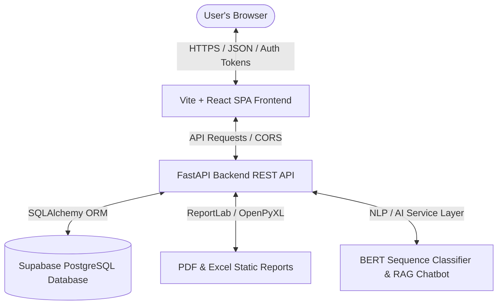
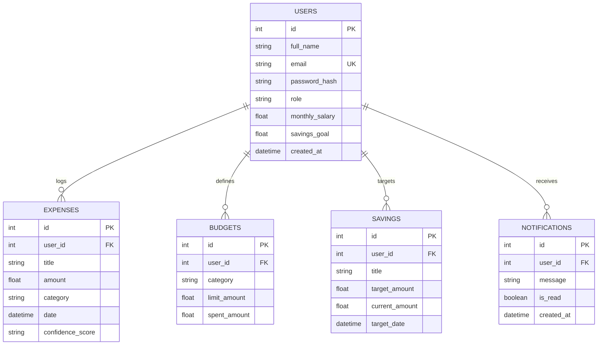

# Comprehensive Project Report
## Smart Personal Finance Manager With AI
**An End-to-End Technical and Architectural Review**

---

## 1. Executive Summary
The **Smart Personal Finance Manager with AI** is a state-of-the-art personal finance tracker designed to combine advanced data-driven automation with a premium, glassmorphic financial dashboard. The core problem it solves is the friction users experience when manually logging transactions and translating financial raw data into actionable insights. 

By integrating **Natural Language Processing (NLP)**, time-series spending projections, financial health scoring algorithms, and an automated report compilation system, the application enables users to easily record expenses using conversational text, visualizes their budget limits in real time, and provides personalized AI-driven advice to improve their savings. 

---

## 2. Technical Stack and Architecture
The project is built on a decoupled, modern **Client-Server Architecture** separating the concerns of the presentation layer, business logic, and database state.

### 2.1. Frontend Technologies (Presentation Layer)
- **Core Framework:** React 18 with TypeScript (Vite bundler) for a rapid Single Page Application (SPA).
- **Styling:** Tailwind CSS combined with custom CSS rules to create a premium **glassmorphism** layout (acrylic blurs, smooth hover state transitions, and responsive grid layouts).
- **Visualizations:** Recharts library utilized for interactive analytics (pie charts, line graphs, bar charts) representing expenses and budget progress.
- **HTTP client:** Axios equipped with request/response interceptors to manage token validation and handle authentication timeouts.

### 2.2. Backend Technologies (Application Layer)
- **Framework:** FastAPI (Python) chosen for its high execution speed, automatic OpenAPI/Swagger documentation, and native async/await capabilities.
- **ORM Database Client:** SQLAlchemy mapping relational database models to python objects.
- **Rate Limiting:** SlowAPI utilizing token-bucket algorithms to prevent denial-of-service abuse.
- **Server:** Uvicorn running ASGI (Asynchronous Server Gateway Interface) pipelines.

### 2.3. Database Layer (State Management)
- **Local Dev Database:** SQLite database (`finance.db`) utilized for seamless local development.
- **Production Database:** Supabase PostgreSQL cloud instance connected over secure TCP sockets.

---

## 3. Database Schema Design
The relational database structure ensures data integrity, fast query execution, and relational mapping (foreign keys).

- **Users Table:** Holds user authentication hashes (`bcrypt`), access control roles (admin vs user), and overall target indicators (monthly salary, savings goals).
- **Expenses Table:** Registers the item details, numeric cost, category group, transaction date, and the machine learning confidence score.
- **Budgets Table:** Tracks the spending cap defined for specific categories vs the current actual expenditures.
- **Savings Table:** Tracks user progress towards dedicated financial benchmarks (e.g. Buying a Car, Emergency Fund).
- **Notifications Table:** Serves as a mailbox system to warn users when their budget limits are close to being breached.

---

## 4. Key Functional Modules

### 4.1. Secure Authentication & Session Handling
The app secures API endpoints using:
- **Passlib & BCrypt:** Safe hash generation for user passwords before database inserts.
- **PyJWT:** Generates cryptographic JSON Web Tokens signed with a HMAC SHA-256 algorithm (`HS256`).
- **Axios Interceptors:** The frontend intercepts requests to dynamically inject the bearer authorization token. It also intercepts response errors to automatically sign out the user if the token has expired (1-day expiration time limit).

### 4.2. Expense Management with Natural Language Processing (NLP)
Instead of standard form entry, users can log transactions through natural text sentences (e.g., *"Spent 1200 rupees on restaurant dinner yesterday"*).
- The system parses the string to identify the cost (`1200`) and the details (`restaurant dinner`).
- **BERT Categorizer:** The input string is sent to a Sequence Classification Model. A trained classifier parses the sentence and maps it to the closest categories (`Food`, `Travel`, `Shopping`, `Entertainment`, `Bills`, `Healthcare`, `Education`, etc.) along with a confidence rating.

### 4.3. Predictive Spending & Financial Health Scores
- **Spending Projections:** Time-series projection algorithms calculate future trends by analyzing chronological spending density, informing users if they are on track to overshoot their budget.
- **Financial Health Index (0-100):** Evaluates a user's financial habits based on:
  - Debt-to-saving ratio
  - Category budget breaches
  - Budget-to-income savings buffers
  It outputs a diagnostic breakdown (Excellent, Good, At-Risk, Vulnerable) along with actionable recommendations.

### 4.4. Automated Static Report Compilation
- **Printable PDFs:** Implemented with `ReportLab` to compile structured summaries, tables of recent logs, key charts, and an official auditor layout.
- **Excel Spreadsheet Logs:** Designed using `OpenPyXL` to generate complete, filterable ledger sheets of all expenses for spreadsheet analysts.

### 4.5. Admin Metrics Control Console
An administration panel allows system owners to observe overall telemetry, including database row counts, active system users, CPU workload metrics, and rate limit statistics.

---

## 5. Deployment Lifecycle (Local to Production)
To transit this from a localized setup to a distributed public service, the project was restructured and deployed across cloud providers.

### 5.1. Refactoring for Production Cloud Ready
1. **Dynamic Service Resolution:** Modified the frontend React application's networking client (`api.ts`) to read the environment variables (`import.meta.env.VITE_API_URL`) instead of hardcoding `localhost:8000`.
2. **Relational Database Adaptability:** Integrated the Postgres driver adapter (`psycopg2-binary`) into the server dependencies to enable connection to highly scalable cloud databases.

### 5.2. Permanent Cloud Infrastructure Deployment
The deployment utilizes three free-tier cloud platforms:

| Layer | Provider | Description | Endpoint Link |
| :--- | :--- | :--- | :--- |
| **Frontend** | **Vercel** | Vite + React Static SPA Distribution | [finance-manager-kappa-two.vercel.app](https://finance-manager-kappa-two.vercel.app) |
| **Backend** | **Render** | FastAPI Python API Server | `https://finance-manager-5enh.onrender.com` |
| **Database** | **Supabase** | Cloud-based Relational PostgreSQL DB | `db.iljjcxnwmrlwekggdpfn.supabase.co` |

- **CI/CD Integrations:** Both Vercel and Render are connected directly to the GitHub repository. Whenever new commits are pushed to the `main` branch, the cloud platforms automatically run tests, build the codebase, and redeploy the site with zero downtime.

---

## 6. Future Enhancements & Scalability
1. **PyTorch Integration:** Load real model weights into `ai_service.py` using HuggingFace's tokenizers to replace the current classification framework.
2. **Email Alerts:** Hook up an SMTP email server (like SendGrid) to automatically email weekly PDF summaries and budget alert notices directly to users.
3. **Plaid Integration:** Connect actual bank accounts using the Plaid API to fetch real-world statements automatically.
